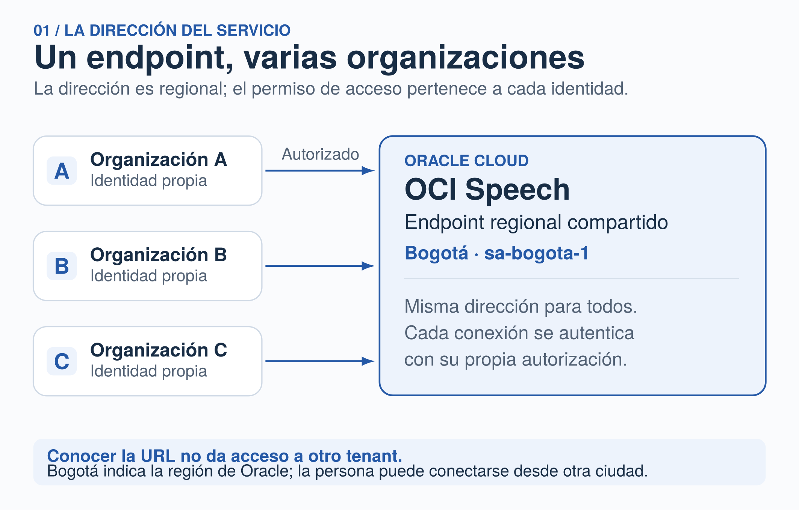
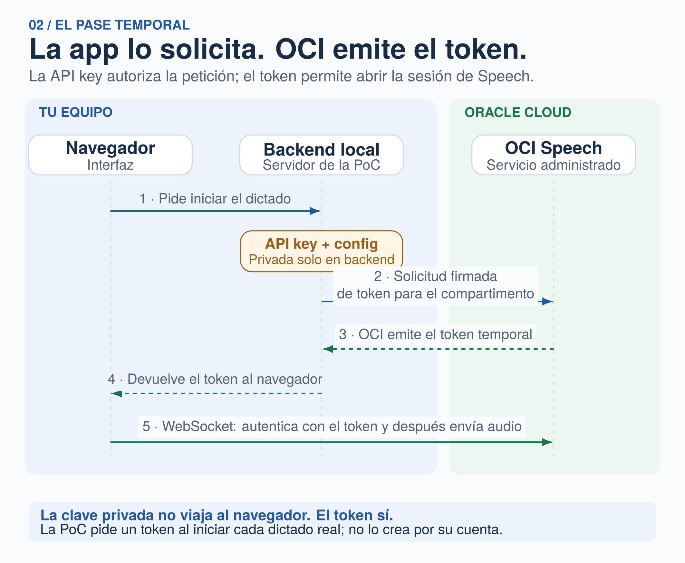
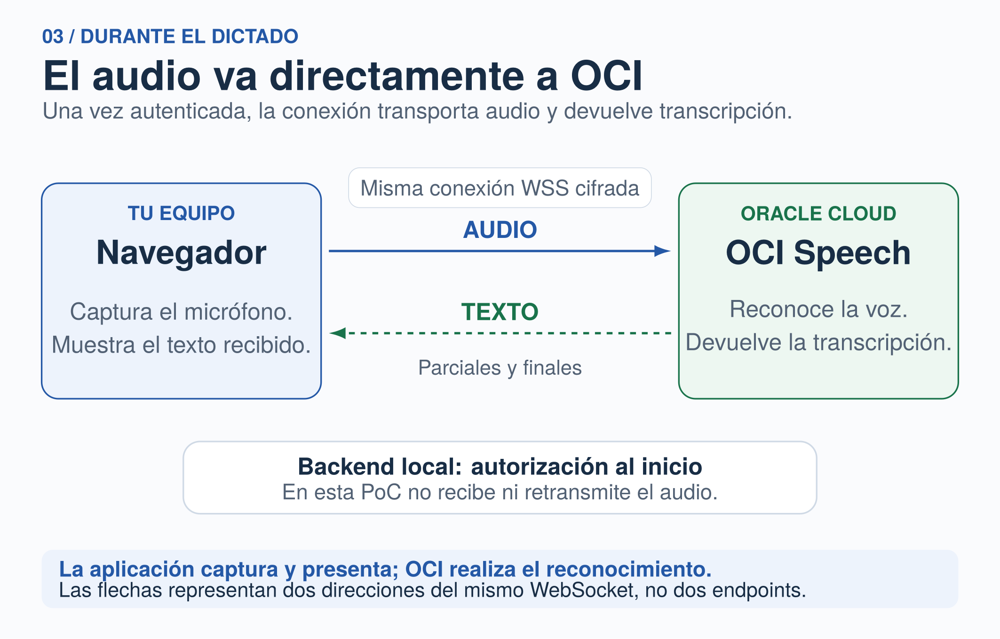
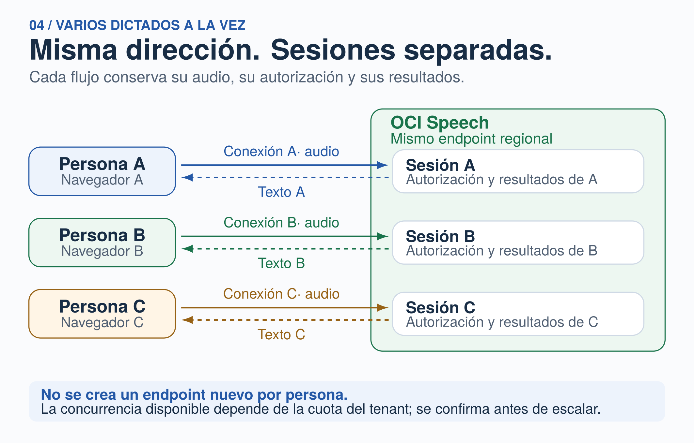

# OCI Speech: endpoint y funcionamiento en tiempo real

OCI Speech es el servicio de Oracle Cloud que convierte audio en texto. Oracle ejecuta y administra el motor de reconocimiento; nuestra aplicación se conecta para utilizarlo. No tenemos que instalar ese motor ni desplegar un servidor de reconocimiento propio.

## Cuál es el endpoint

Para la transcripción en tiempo real de nuestra prueba en Bogotá utilizamos:

```text
wss://realtime.aiservice.sa-bogota-1.oci.oraclecloud.com/ws/transcribe/stream
```

Un **endpoint** es la dirección a la que una aplicación se conecta para consumir un servicio. En esta dirección:

- `wss://` indica una conexión WebSocket cifrada, que permite enviar audio y recibir texto por la misma conexión.
- `sa-bogota-1` identifica la región Bogotá.
- `/ws/transcribe/stream` identifica la ruta para transcripción en tiempo real.

La dirección resulta del patrón regional publicado por Oracle y la ruta de su ejemplo oficial. También es la dirección configurada en nuestra prueba. Es un endpoint regional compartido: otros tenants pueden usar la misma dirección con sus propias autorizaciones. Conocerla no concede acceso a nuestro tenant. Bogotá indica la región de Oracle, no la ubicación física que debe tener quien se conecta.



**Una dirección compartida no significa una cuenta compartida:** cada conexión debe autenticarse con una identidad autorizada.

## El endpoint permanece; cada sesión empieza y termina

Oracle mantiene el servicio y publica su dirección. No creamos un endpoint nuevo cada vez que alguien quiere dictar ni tenemos que encender una máquina nuestra para alojar el motor.

Lo que abrimos al iniciar el dictado es **una conexión o sesión temporal** con ese servicio. Mientras está activa, enviamos audio y recibimos texto. Al terminar cerramos esa conexión; la dirección del servicio sigue siendo la misma para otras sesiones. Esto no significa disponibilidad garantizada sin interrupciones: el acceso depende del servicio, la red, los permisos y sus límites.

## API key, config y token: qué hace cada uno

La app **no inventa ni firma por su cuenta el token de Speech**: usa las credenciales configuradas para pedirlo a OCI. **OCI lo emite y la app lo utiliza temporalmente.** No hay que descargarlo ni copiarlo manualmente.

| Elemento | Para qué sirve | Dónde se utiliza en esta PoC |
| --- | --- | --- |
| API signing key | El par registrado en OCI permite autenticar solicitudes; la privada firma la petición mediante el SDK | Backend local; la privada no se entrega al navegador |
| Config | Indica usuario, tenant, fingerprint, región y ubicación de la privada | Backend local; no es el token ni contiene el audio |
| OCID del compartimento | Identifica el compartimento autorizado para solicitar la sesión | Configuración local y solicitud/autenticación de Speech |
| Token temporal de Speech | Autoriza la conexión de transcripción sin entregar la privada al navegador | OCI lo devuelve al backend; este lo pasa al navegador |

Piensa en la API key como la identificación para pedir un pase, y en el token como ese pase temporal. **Configurar la API key no significa que el token ya esté creado.**



El diagrama separa el equipo local de Oracle Cloud. El recorrido completo es el siguiente.

En modo OCI, al pulsar **Iniciar dictado**:

1. El navegador pide autorización al backend local mediante `POST /api/speech/session`.
2. El backend utiliza la identidad y privada configuradas para llamar a `CreateRealtimeSessionToken`, incluyendo el compartimento.
3. OCI comprueba la solicitud conforme a IAM y devuelve el token temporal, junto con el identificador de sesión y el compartimento.
4. El backend entrega esos datos al navegador. Este abre el WebSocket y envía el token en el mensaje de autenticación, no dentro de la URL.
5. Una vez autenticado, el navegador transmite audio directamente a OCI y recibe texto. El backend local no transporta ese audio.

Nuestra app solicita un token nuevo para cada inicio de dictado que llega a la autorización. Mantiene el token en memoria de ejecución y no lo guarda automáticamente en archivos ni lo imprime. El modo demo no solicita tokens. La duración y validez del token las determina OCI; los cinco minutos de duración máxima de la PoC son una decisión local y no equivalen al tiempo de validez del token. Cerrar el WebSocket no debe interpretarse como una revocación instantánea del token.

El token también es sensible mientras sea válido: no se comparte ni se publica. El compartimento se especifica en la solicitud y en la autenticación de la sesión; no se añade su nombre a la dirección del WebSocket. Los permisos IAM determinan el acceso efectivo.

## Qué ocurre cuando alguien habla



Después de obtener el token y autenticar el WebSocket, el navegador envía fragmentos de audio mientras la persona habla. OCI devuelve texto provisional y segmentos finales por esa misma conexión. Al terminar, la aplicación cierra su conexión. Las dos flechas representan direcciones distintas del mismo WebSocket, no dos endpoints.

La aplicación captura y presenta; OCI realiza el reconocimiento. La puntuación automática es una opción de la sesión: no requiere crear otro endpoint.

## Varias transcripciones al mismo tiempo

Se utiliza el mismo endpoint y se abre una conexión independiente para cada flujo de audio. Cada sesión tiene su autorización y la aplicación debe mantener separados el audio y los resultados:



La persona A envía audio por la conexión A y recibe texto A; lo mismo ocurre de forma independiente con B y C. Los rótulos y las flechas permiten distinguir cada flujo sin depender únicamente del color.

No se crean tres endpoints ni se mezclan los audios en una sola conexión. Para una aplicación con varios usuarios se debe gestionar capacidad, errores y asociación de resultados por sesión.

Oracle documenta **10 sesiones concurrentes por tenant**, dentro de los límites aplicables por región, con posibilidad de solicitar aumento a soporte. No son diez por usuario o por compartimento. El propietario debe confirmar el límite efectivo del tenant antes de planear más concurrencia; este documento no acredita que se haya ampliado. [Límites oficiales de Speech](https://docs.oracle.com/en-us/iaas/Content/speech/using/speech.htm).

La PoC actual permite un dictado activo por interfaz; no implementa administración central de usuarios ni reserva de cupos entre equipos. Tener un endpoint compartido no convierte esa interfaz en una aplicación multiusuario.

## Explicación para compartir

> OCI Speech ya ofrece un servicio de transcripción en Oracle Cloud. Nuestra aplicación abre una conexión autorizada a su endpoint de Bogotá, envía audio y recibe texto en tiempo real. La dirección del servicio permanece; cada dictado abre y cierra su propia conexión. Para autorizar cada dictado, el backend usa la API key y el config para pedir un token temporal a OCI; el navegador utiliza ese token. Varias transcripciones usan conexiones separadas a la misma dirección. No desplegamos el motor de reconocimiento: consumimos el que administra Oracle.

## Fuentes y alcance

- [Oracle: SDK web de Speech realtime](https://github.com/oracle/oci-ai-speech-realtime-web-sdk): patrón de dirección regional y uso desde navegador.
- [Oracle: ejemplo de cliente](https://github.com/oracle/oci-ai-speech-realtime-web-sdk/blob/main/example-client/react-client/src/App.tsx): token, ruta de transcripción, parámetros y resultados.
- [Oracle: ejemplo de backend y solicitud de token](https://github.com/oracle/oci-ai-speech-realtime-web-sdk/blob/main/example-client/index.ts): `CreateRealtimeSessionToken` y devolución al frontend.
- [Oracle: regiones](https://docs.oracle.com/en-us/iaas/Content/General/Concepts/regions.htm): identificador de Bogotá.
- [Configuración local de referencia](../src/shared/settings.ts): dirección usada por esta PoC. [Emisión del token](../src/server/auth.ts) y [conexión](../src/client/connection.ts): modalidad implementada.

Fuentes revisadas el 24 de noviembre de 2026. Documento conceptual; no se ejecutaron solicitudes contra OCI para prepararlo. No contiene credenciales ni configura un servicio.
